# postit-board

A glass board of sticky notes for the home screen of your app: people drag notes around, your app pins its own (and takes them down when the problem is gone), and a color legend in the footer says what each color means. Notes people are done with go to Archived, and the board can split into lanes: a Kanban by state, or columns by category.

Vanilla JS, zero runtime dependencies, about 165 kB unminified (48 kB gzipped, most of it comments), and it runs under a strict Content-Security-Policy. A SQLite store for Node comes with it.


**[Live demo](https://rbritta.github.io/postit-board/demo/)** ([Kanban](https://rbritta.github.io/postit-board/demo/kanban.html), [Categories](https://rbritta.github.io/postit-board/demo/categories.html), [Archived](https://rbritta.github.io/postit-board/demo/archived.html)) · [Use it](#use-it) · [Options](#options) · [Server](#server) · [For AI agents](AGENTS.md) · [Roadmap](TODO.md)

## What it does

- **Two kinds of notes.** Notes people write (edit ✎, archive ✓) and notes your app computes on every render. App notes have a folded corner, can't be edited or archived, and disappear when your app stops sending them. Their menu opens their link or dismisses them until your app says something new, and so does a drop on the box. Only their position (and that Dismiss) is stored. [More](#app-notes).
- **Archive, with Undo.** The ✓, the menu or a drop on the Archive box takes a note off the board into Archived. A short "Archived · Undo" line stays at the bottom for 6 seconds. [More](#archive-and-archived).
- **Archived.** The Archived button next to "+ Note" swaps the notes for a table of the archived ones: filter them, put one back on the board, or delete it for good.
- **Lanes, off by default.** Split the glass into columns by state (To do → Doing → Done) or by category (Work, Home, Ideas). Each note keeps a value in both, and dragging it to another lane changes it. [More](#lanes).
- **A legend that filters.** Each color gets a meaning in the footer. Click an item to hide or show that color, on the board and in Archived.
- **Right-click to add, right there.** Right-click the glass and pick a type: the note starts exactly where you clicked (in that lane, with lanes on). Right-click a note for State or Category ▸, Color ▸, Edit and, last, Archive; an app note for Open → and Dismiss. Shift + right-click keeps the browser menu. A new note starts on its title.
- **Board settings.** The gear at the end of the legend has three tabs: Types (rename a type, say what it means, pick another color, add or remove one; types your app owns, `locked`, can only be renamed), Lanes and View. Saved through the store.
- **Last touched on top.** The note you drag or click comes to the front and stays there after a reload. While dragged, the note lifts off the glass and follows the pointer anywhere; dropped outside, it glides back to the edge.
- **A title alone sits in the middle.** A note with a title and nothing else shows it centered above its footer, in up to 4 lines (`--pb-title-only-lines`).
- **Due times.** A note can have a due time. The chip turns amber on the day and red when late. On the server, `watchDue` calls you once when the time comes (send a chat message, a push, a calendar event: your call).
- **Images and links.** A note can show an image, a link with a label, and any bare URL in its text becomes a link.
- **Phones too.** Below 700 px wide the board becomes a plain grid with no horizontal scroll. Holding a note opens its menu as a sheet from the bottom; lanes become stacked sections that fold. The most urgent notes can come first, and the rest can wait behind "Show N more". [More](#narrow-screens).
- **Long text, read whole.** A note whose text is cut ("…") opens big in the center of the screen, growing out of its own place on the board, and goes back into it when you close it. Or, picked in the gear, it grows in place on hover, or gets a "more" link. Every way is a short, smooth transition, and an instant change when the system asks for reduced motion.
- **Keyboard.** Tab to a note, arrows move it (Shift for bigger steps, and into the next lane at a lane's edge), Enter opens or edits it, the menu key or Shift+F10 opens its menu (→ opens a submenu, ← closes it), Esc closes and gives the focus back to the note.
- **Safe by default.** Every text is escaped, only `http(s)` and relative URLs are accepted, and nothing needs inline styles, inline handlers or `eval`, so a strict CSP is fine.

<p>
  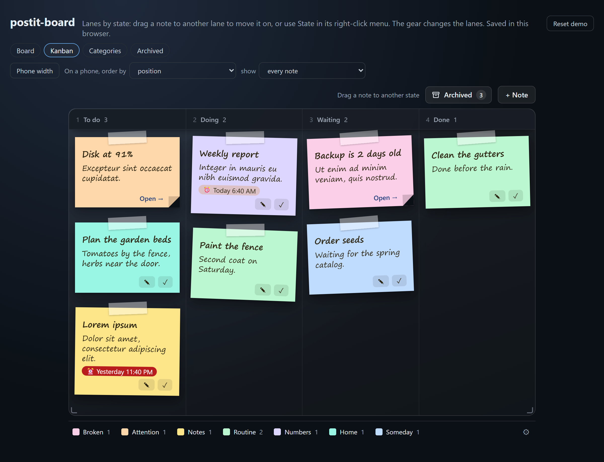
  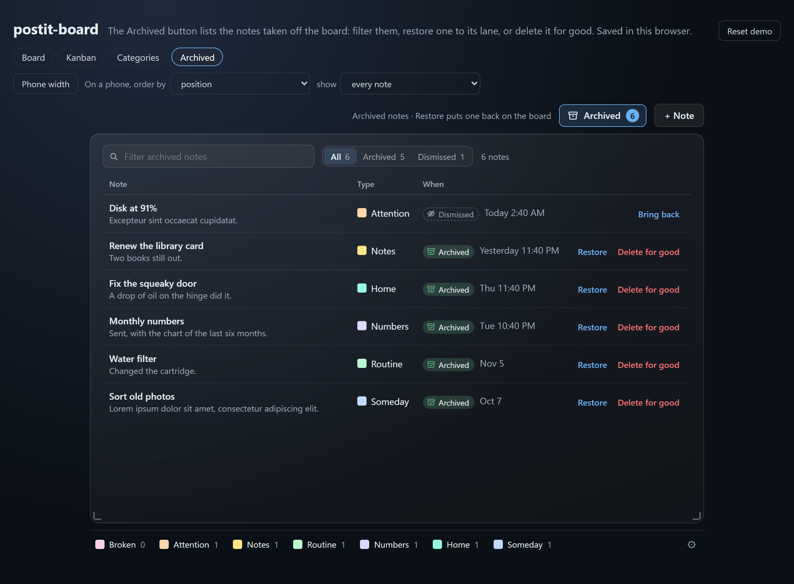
</p>
<p>
  
  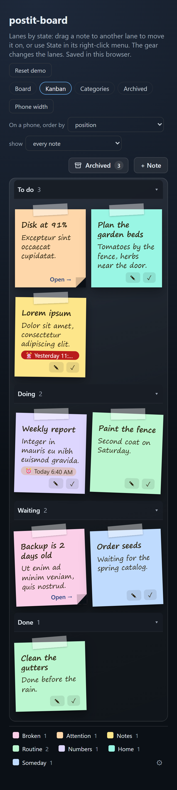
  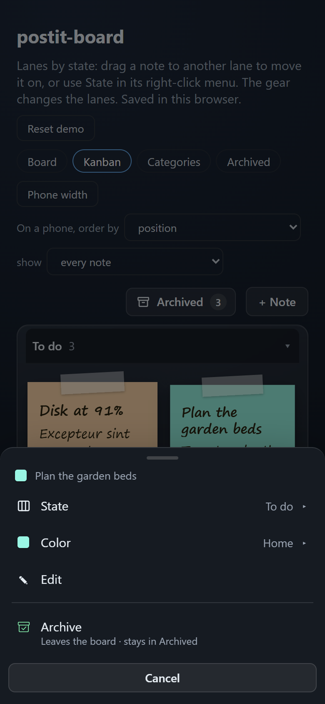
  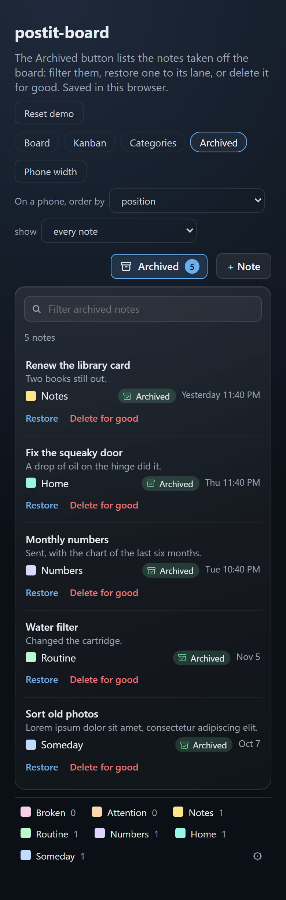
</p>
<p>
  
  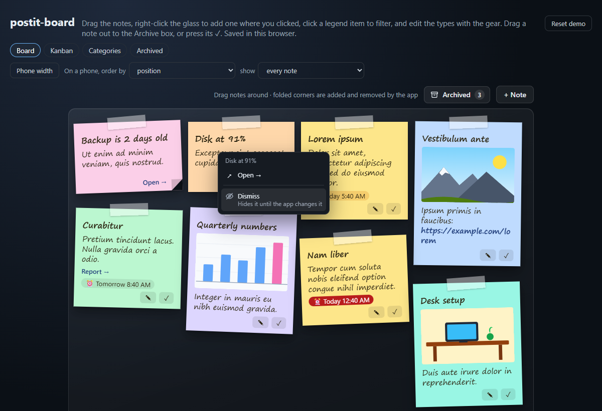
</p>
<p>
  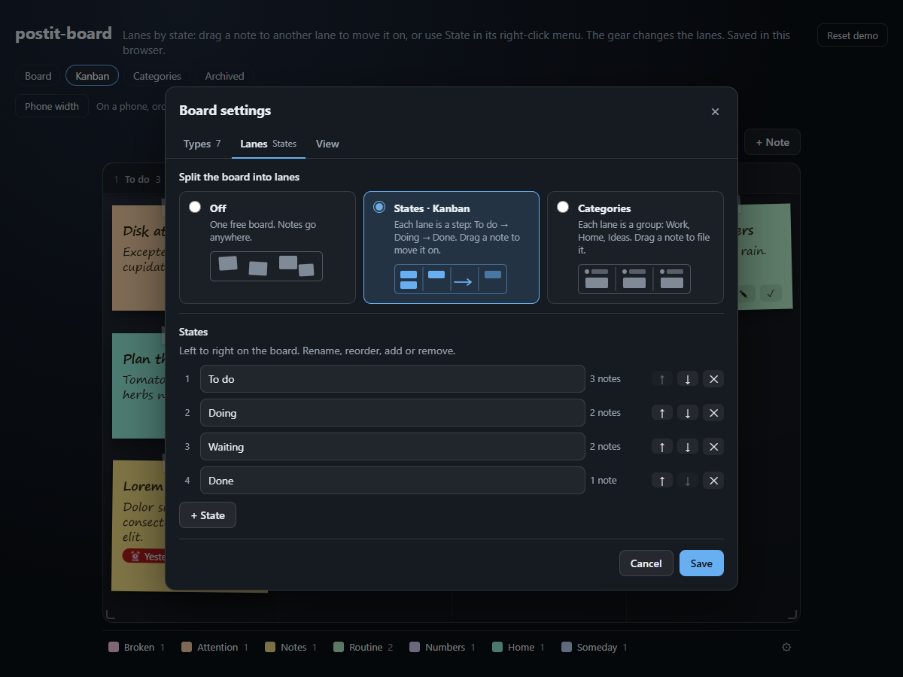
</p>
<p>
  
  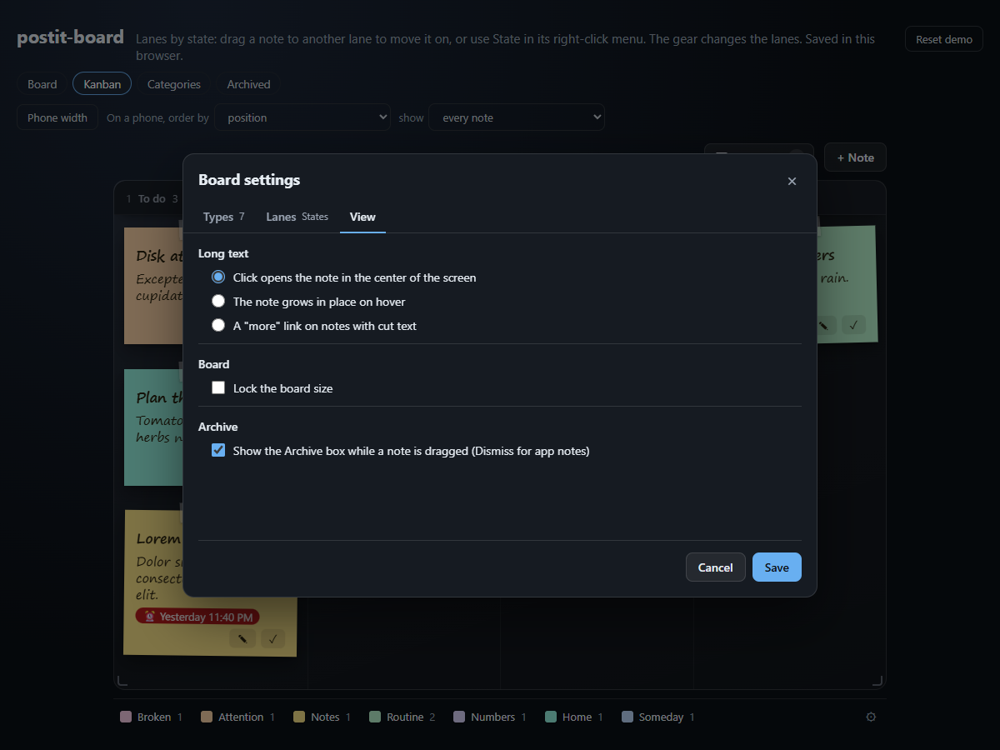
</p>
<p>
  
  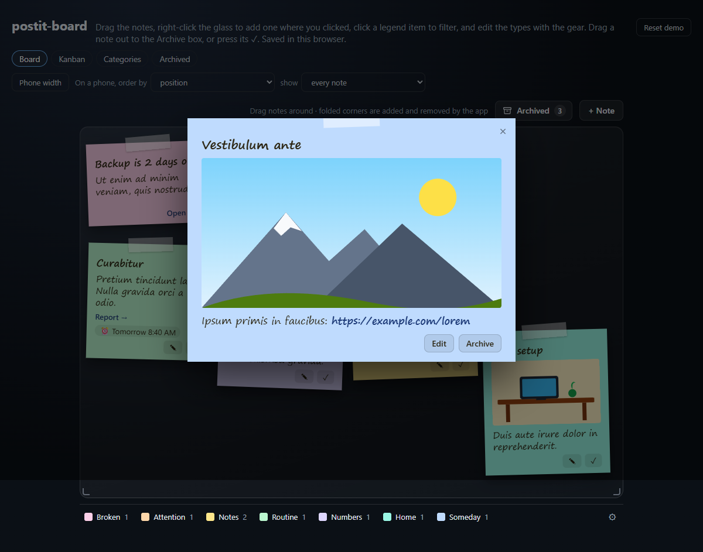
</p>

## Use it

```sh
npm install github:rbritta/postit-board
```

```html
<link rel="stylesheet" href="node_modules/postit-board/src/postit-board.css">
<div id="board"></div>

<script type="module">
  import { createBoard, restStore } from 'postit-board';

  const board = createBoard(document.getElementById('board'), {
    store: restStore('/api/postits'),
    legend: [
      { color: 'pink', label: 'Broken' },
      { color: 'yellow', label: 'Notes' },
      { color: 'blue', label: 'Someday', description: 'Future improvements' },
    ],
    // what your app computes right now; give each one a stable key
    auto: [{ key: 'disk', title: 'Disk at 91%', color: 'pink', link: '/disk', linkLabel: 'Open →' }],
  });
  board.reload();                       // loads notes, positions, settings and the archived list from the store

  // later, when your data changes:
  board.update({ auto: computeAlerts() });
</script>
```

No bundler and no modules? Use the classic build, which defines `window.PostitBoard`:

```html
<link rel="stylesheet" href="dist/postit-board.css">
<script src="dist/postit-board.global.js"></script>
<script>PostitBoard.createBoard(el, { store: PostitBoard.localStore('my-board') });</script>
```

## Options

| Option | Default | What it is |
| --- | --- | --- |
| `store` | `null` | Where changes go: `restStore(url)`, `localStore(name)` or your own `{ load, create, update, archived?, saveLegend?, saveLanes?, saveSize?, saveView? }`. |
| `legend` | `[]` | `[{ color, label, description?, locked?, hex? }]`, in footer order: the note types. `locked` types belong to the app (rename only). `hex` repaints a color. |
| `auto` | `[]` | App notes: `{ key, title?, text?, color?, link?, linkLabel?, image?, due?, lane? }`. `lane` is the lane they sit in (an id or a name, or `{ states, categories }`); without it, the first lane. People can dismiss one until its title, text, due, link or color change ([App notes](#app-notes)). |
| `notes` | `[]` | Written notes, if you load them yourself instead of `reload()`. |
| `lanes` | off | `{ mode: 'off' \| 'states' \| 'categories', states?, categories? }`, each list `[{ id, name }]` left to right. Left out, a list is the preset one (To do, Doing, Waiting, Done; Work, Home, Ideas). What people set in the gear wins. |
| `colors` | built-in | Extra or replaced colors: `{ coral: '#fecaca' }`. Keys are lowercase. |
| `strings` | English | Every visible word, e.g. `{ add: '+ Nota', archive: 'Arquivar', today: 'Hoje', showMore: 'Mais {n}' }`. See `DEFAULT_STRINGS`; `{n}`, `{title}`, `{lane}` are filled in. |
| `locale` | browser | Language of the due times (`'pt-BR'`, `'en-GB'`…). See [Dates and times](#dates-and-times). |
| `timeZone` | browser | Time zone the due times are read in, e.g. `'America/Sao_Paulo'`. |
| `hour12` | the locale's | `true` for `5:30 PM`, `false` for `17:30`; left out, the locale decides. |
| `defaultColor` | `yellow` | Color of a new note. |
| `addButton` | `true` | Show the "+ Note" button. Double-clicking the glass also adds one. |
| `archivedButton` | store has `archived` | Show the Archived button. Without `archived()` in the store there is nothing to list, so it hides, until an app note is dismissed (it lists those too). |
| `archiveBox` | `true` | Show the Archive box while a note is dragged. People can turn it off in the gear (View). |
| `contextMenu` | `true` | Right-click menus: a new note of a type where you clicked, a note's State or Category, Color, Edit and Archive, and an app note's Open → and Dismiss. Also the long press on a phone. |
| `editLegend` | store has `saveLegend` | Show the gear (board settings). |
| `gridBelow` | `700` | Width (px) under which the board is a grid. Keep it equal to the CSS container query. |
| `narrowOrder` | `'position'` | The order of the notes on a narrow screen: `'position'` keeps the board's order; `'priority'` puts overdue notes first, then the ones due today, then by type in legend order, then by position. Written and app notes alike, inside each lane with lanes on. |
| `narrowLimit` | none | On a narrow screen, show only the first N notes (in that order), then a "Show N more" row that opens in place, and "Show less" under them. Each lane folds on its own. It stays open until the page reloads. |
| `resizable` | `true` | Drag either bottom corner to resize the board (centered, min 480 × 320 px). Double-click a corner to reset. The gear can lock it. |
| `width` | `0.8` | Default share of the width the board takes (10% margin on each side). |
| `size` | `null` | A saved `{ width, height, locked }` to start with, as `store.load()` returns it. |
| `expand` | `'center'` | How a note with cut text ("…") shows the rest: `'center'` opens it big on click, `'inplace'` grows it on hover, `'more'` adds a link. People can change it in the gear. |
| `view` | `null` | A saved `{ expand, archiveBox }` to start with, as `store.load()` returns it. |
| `onError` | `console.error` | Called when the store fails. The board also fires a `postit-error` event. |

The returned board has `update({ notes?, auto?, positions? })`, `reload()`, `configure(options)` (any option above, applied at once), `openEditor(draft?)`, `openSettings(tab?)` (`'types'`, `'lanes'` or `'view'`), `showArchived(on?)`, `openNote(ref)`, the getters `notes`, `archived`, `dismissed` (the app notes dismissed that your app still sends, each with its `dismissed` signature and `dismissedAt`), `legend`, `lanes`, `size` and `view`, and `destroy()`.

The legend people saved comes back in `store.load()` and is merged over the one you pass (`mergeLegend`): their order, names and colors win, and your `locked` types are always there. A note whose type was removed keeps its color, it just leaves the legend. The lanes people saved replace the ones you pass.

Built-in colors: `yellow`, `pink`, `green`, `blue`, `orange`, `purple`, `teal`, `gray`. Styling is plain CSS custom properties on `.pb` (`--pb-accent`, `--pb-note-width`, `--pb-font`, `--pb-text-lines` and `--pb-title-lines` for where long text is cut with "…" (`--pb-title-only-lines` for a title alone), `--pb-link` and `--pb-link-hover`, `--pb-surface` and `--pb-surface-fg` for the dialogs, the menu and the toast, `--pb-done` for the Archive box, `--pb-lane-head` and `--pb-line` for the lanes, `--pb-sticky-top` for where the lane headers stick under a fixed app header…). Add `data-theme="light"` for light pages.

The transitions take `--pb-motion-in` (240 ms, a note opening, the Archive box coming) and `--pb-motion-out` (180 ms, going back); `0ms` turns them off, and `prefers-reduced-motion: reduce` always does.

## Archive and Archived

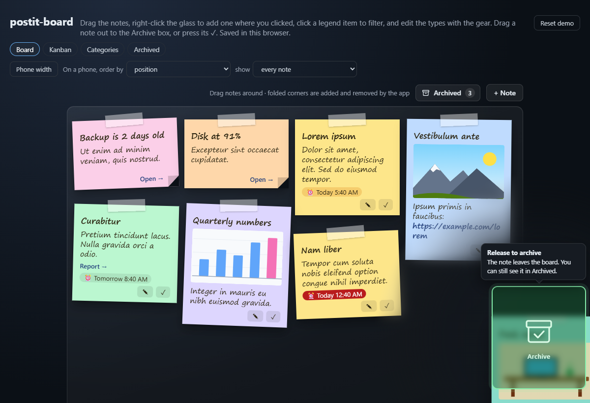

Archiving takes a note off the board without losing it. It is the note's `done` flag in the store (`doneAt`, the time), so boards from before 0.7.0 already have their done notes in Archived.

- **The ✓, the menu's Archive (always its last item) and the reader's Archive** send the note flying into the Archived button.
- **Drag a note out to the Archive box.** As soon as a written note moves, it lifts off the glass and follows the pointer anywhere on the screen, and a box appears astride the glass edge on the side nearer the note: a third of it over the glass, so a note dragged to the edge touches it, the rest in the margin (as big as a note when there is room, smaller when the margin is narrow, else a pill in the bar above the glass, else at the window's edge). It stays put while you drag, the note passes under it, and a balloon says what the drop does. Only the pointer on the box archives: a note that just overlaps it, or a drop beside it, moves as usual. Dropped outside the glass and off the box, the note glides back to the nearest place inside, at the edge. A soft blur around the box dims what is near it and never catches a click or a drop.
- **Undo.** "Archived “…” · Undo" stays at the bottom for 6 seconds, and Undo puts the note back where it was, in its lane. The Archived count pulses when a note lands there.
- **App notes are never archived:** no ✓ and no Archive in their menu. Dragged, they get the same box saying Dismiss ("Drop here to dismiss"), and a drop on it dismisses them ([App notes](#app-notes)).
- **On a phone** there is no drag: hold a note for its menu (a sheet from the bottom), or press its ✓. The box and its blur come over the note and it sinks in.
- **Archived** (the button next to "+ Note", with the count) shows a table in the glass: the note (title and text), its type, its lane (only with lanes on), When (an "Archived" chip and the date), and Restore and Delete for good. Filter it with the search field or the legend. Restore puts the note back in its lane and place, or in the first lane when its lane is gone. Delete for good asks in the row first and has no Undo. On a phone each row is a card, chip included. App notes people dismissed are in the same list, by date, with a "Dismissed" chip and Bring back instead; while there is one, "All · Archived · Dismissed" next to the search field picks which show.
- The gear's View tab can hide the box ("Show the Archive box while a note is dragged (Dismiss for app notes)", on by default), for both kinds of notes. The ✓ and the menu still archive or dismiss.

The Archived button needs a store with `archived()`. `restStore`, `localStore` and the SQLite store have it; a store of your own without it simply has no button, and archiving still works.

## Lanes

Off by default. The gear's Lanes tab picks one of three:

- **Off:** one free board, as before.
- **States · Kanban:** each lane is a step (To do, Doing, Waiting, Done by default). The bar says "Drag a note to another state".
- **Categories:** each lane is a group (Work, Home, Ideas by default).

Each mode keeps its own list: rename, reorder, add or remove lanes there (a warning past 5, at most 12). Removing a lane with notes asks where they go (the neighbor by default), with Undo until you save. A note keeps a value in both modes (`lane: { states, categories }`) and its own place inside its lane in each (`lanePos`), so switching modes never loses anything; a note with no value is in the first lane. Colors keep meaning the type in every lane.

The glass shows columns with each lane's name and count. Notes stay free inside their lane; dragging one to another lane changes its state or category (the lane lights up while you drag), and so do State ▸ or Category ▸ in its menu, the editor's lane field and the arrow keys at a lane's edge. No note ever sits over the header row: notes start below it, a drop near the top lands below it, the note you drag slides under it, and the row sticks to the top when the page scrolls (`--pb-sticky-top` for a fixed app header). Right-click the empty glass and the new note starts in that lane ("New note here · Doing").

On a phone, lanes are stacked sections with sticky titles that fold.

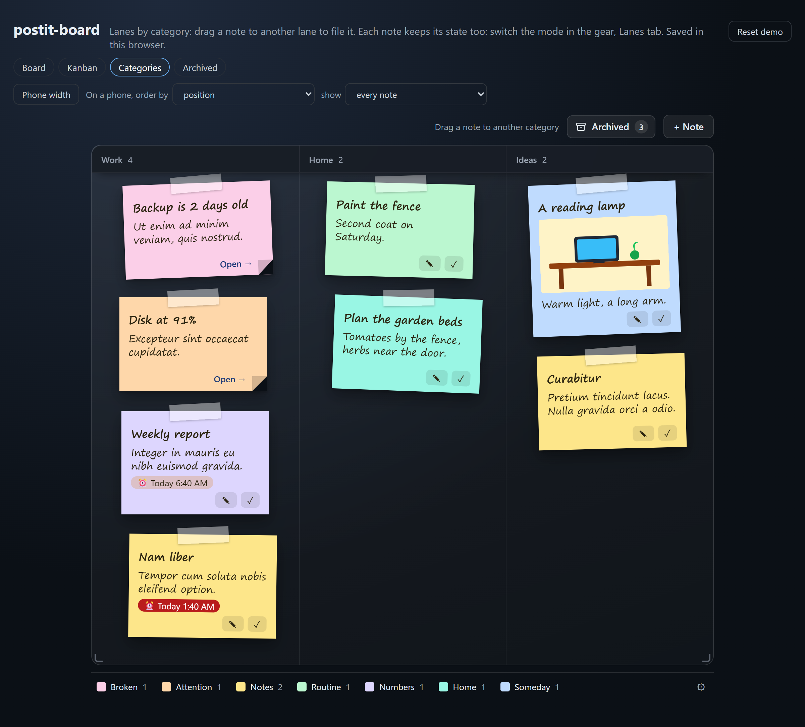

App notes say their lane with `lane` (an id or a name; or `{ states, categories }` for both modes). Without one, or with one that is not in the list, they sit in the first lane. They can be dragged inside their lane, not out of it.

```js
createBoard(el, { store, lanes: { mode: 'states' } });   // start as a Kanban; people can change it in the gear
createBoard(el, { lanes: { mode: 'categories', categories: [{ id: 'ops', name: 'Operations' }, { id: 'sales', name: 'Sales' }] } });
board.update({ auto: [{ key: 'backup', title: 'Backup failed', color: 'pink', lane: 'ops' }] });
```

## Narrow screens

Below `gridBelow` (700 px) the board is a grid without dragging. Two options decide what a phone shows first, and leave the desktop untouched:

```js
createBoard(el, { narrowOrder: 'priority', narrowLimit: 6 });
```

- `narrowOrder: 'priority'`: overdue notes first, then the ones due today, then by type in legend order, then where they were. Written and app notes alike.
- `narrowLimit: 6`: the first 6, then "Show N more" (`strings.showMore`), which opens the rest in place with a short transition; "Show less" (`strings.showLess`) folds it again. It stays as people left it until the page reloads.

With lanes on, both apply inside each lane's section. The demo pages have a "Phone width" switch and both options in their header.

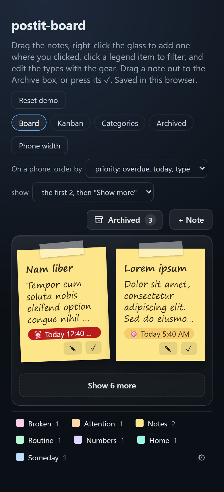

## App notes


App notes are yours: the board never edits, recolors, moves to another lane or archives them. People still get a menu on them (right-click, the menu key, or a long press on a phone):

- **Open →** when the note has a `link`: the same as clicking its link.
- **Dismiss** ("Hides it until the app changes it"), or **drag it to the box**, which says Dismiss for an app note (same box, same place, same blur): the note leaves the board, with "Dismissed “…” · Undo" for 6 seconds and the Archived count pulsing. A drop anywhere else just moves it, as before. The board keeps a signature of what the note said (its title, text, due time, link and color; `autoSignature(note)`) under its key, and hides it while you send the same content. When any of those change, it shows again by itself. Its place and lane do not count.
- **In Archived**, the dismissed app notes your app still sends are listed with the archived ones, newest first, each with a "Dismissed" chip (the eye of the menu item, "From the app · it comes back when the app changes it" on hover) and the date it was dismissed, and **Bring back** (no Restore, no Delete for good: they are yours). "All · Archived · Dismissed" filters them. With a store without `archived()`, the Archived button shows as soon as one is dismissed.

The store keeps the Dismiss next to the position, by key:

```js
store.update({ key: 'disk' }, { dismissed: 's1:1x2y3z' });  // Dismiss (a string of at most 100 characters); the store sets dismissedAt
store.update({ key: 'disk' }, { dismissed: null });         // Undo or Bring back; dismissedAt goes too
await store.load();  // { notes, positions: { disk: { x, y, z, lanePos?, dismissed?, dismissedAt? } }, ... }
```

`restStore` sends it as `PUT /key/:key { dismissed }`, `localStore` keeps it in the browser, and the SQLite store in the `dismissed` and `dismissed_at` columns (`dismissedAt` is the server's time, ISO). A wrapper that sits between the board and your store only has to pass `{ key }` updates through as they are. The words are strings like the rest: `open`, `dismiss`, `dismissHint`, `dismissedToast` ("Dismissed “{title}”"), `dropDismiss`, `releaseDismiss`, `dismissBalloon`, `bringBack`, `dismissedChip`, `archivedChip`, `dismissedTitle`, `filterKind`, `filterAll`, `filterArchivedOnly` and `filterDismissed`.

## Dates and times

By default the board reads due times the way the person's browser does: in its language, in its time zone and with its clock (12 or 24 hours). Nothing to set for that. An app that wants something else says so with three options, at creation or later with `configure`:

```js
createBoard(el, { locale: 'pt-BR', strings: { today: 'Hoje', tomorrow: 'Amanhã' } }); // "Amanhã 17:30", "sex. 09:00"
createBoard(el, { timeZone: 'America/Sao_Paulo' });     // which day is "Today" and which hour, wherever the browser is
createBoard(el, { locale: 'en-US', hour12: false });    // American words with a 24-hour clock
board.configure({ timeZone: 'UTC' });                    // change it later; the chips redraw at once
```

- `locale` picks the words of the date (`Fri`, `20 nov.`) and, unless `hour12` says otherwise, 12 or 24 hours as that language writes them. The words "Today", "Tomorrow" and "Yesterday" are `strings` (`today`, `tomorrow`, `yesterday`).
- `timeZone` decides the day as well as the hour: a note due at 01:30 UTC is "Tomorrow 01:30" in London and "Today 22:30" in São Paulo.
- A locale or a zone the browser does not know falls back to the browser's own instead of breaking the board.
- The date field in the editor is the browser's `datetime-local`, which always speaks the browser's own zone.
- The same options write when a note was archived, in Archived ("Today 9:30 AM", "Thu 18:00", "Nov 4"; `formatWhen`).

## Server

```js
import { DatabaseSync } from 'node:sqlite';            // or better-sqlite3
import { createSqliteStore, createHttpHandler, watchDue } from 'postit-board/server';

const store = createSqliteStore(new DatabaseSync('board.db'), { onChange: (e) => audit(e) });
const handle = createHttpHandler(store, { prefix: '/api/postits' });

http.createServer(async (req, res) => {
  // authenticate and check CSRF first: the handler trusts whoever reaches it
  if (await handle(req, res)) return;
  // ...the rest of your app
}).listen(3000);

watchDue(store, { onDue: (note) => notify(`⏰ ${note.title || note.text}`) });
```

| Route | Body | Answer |
| --- | --- | --- |
| `GET /api/postits` | | `{ notes, positions, legend?, lanes?, size?, view? }` |
| `GET /api/postits/archived` | | `{ notes }`, the archived notes, the last archived first |
| `POST /api/postits` | a note | the note |
| `PATCH /api/postits/:id` | fields (`lane`, `lanePos` too), or `{ done: true }` to archive, `{ done: false }` to restore, `{ removed: true }` to delete for good | the note |
| `PUT /api/postits/key/:key` | `{ x, y, z, lanePos, dismissed }` (any of them; `dismissed` is a string of at most 100 characters, or `null`) | the position of an app note, with `dismissed` and `dismissedAt` when it is dismissed |
| `PUT /api/postits/legend` | `{ legend }` | `{ legend }`, the note types edited with the gear |
| `PUT /api/postits/lanes` | `{ lanes }` | `{ lanes }`, the lanes set in the gear |
| `PUT /api/postits/size` | `{ size }` | `{ size }`, the board size from the corners (and the lock) |
| `PUT /api/postits/view` | `{ view }` | `{ view }`, how cut text opens and whether the Archive box shows |

Nothing is deleted: archived and removed notes keep their row with a timestamp. Notes accept a `meta` object (JSON) for your own links, like a customer or ticket id. A table made by an older version gets the new columns (`lane`, `lane_pos`, `dismissed`, `dismissed_at`) in place the first time 0.7.0 opens it.

`onChange` on the store gets one event per change, which makes an audit log easy:

| `type` | When | Also has |
| --- | --- | --- |
| `create` | a note was written | `note` |
| `update` | a note changed (text, color, place, lane…) | `note`, `before`, `patch` |
| `done` | a note was archived | `note`, `before`, `patch` |
| `restore` | an archived note went back on the board | `note`, `before`, `patch` |
| `remove` | a note was deleted for good | `note`, `before`, `patch` |
| `dismiss` | an app note was dismissed, or brought back | `key`, `dismissed` (the signature, or `null` when it came back), `dismissedAt`, no `note` |
| `legend`, `lanes`, `size`, `view` | a setting was saved | the setting (`legend`, `lanes`, `size` or `view`), no `note` |

A store of your own gets the same calls from the board: `archived()` returns `{ notes }` (or a plain list) of notes with `doneAt`; restore is `update(ref, { done: false })` and delete for good is `update(ref, { removed: true })`; Dismiss is `update({ key }, { dismissed })`, and `load()` returns it in `positions[key].dismissed` (with `dismissedAt`, which the board shows in Archived); `saveLanes(lanes)` keeps the lanes next to the legend and `load()` returns them as `lanes`.

## Develop

```sh
npm install          # only playwright-core, for the browser tests and screenshots
npm test             # unit, server and browser tests (installed Chrome; set PW_CHANNEL=msedge for Edge)
npm run demo         # http://localhost:5178/demo/ (and kanban.html, categories.html, archived.html)
npm run build        # dist/ (commit it: script-tag users take it from the repo)
npm run screenshots  # regenerates docs/*.png from the demo
```

Node 22.5 or newer (for `node:sqlite` in the tests). Issues and pull requests are welcome; keep it dependency-free.

## License

[MIT](LICENSE)
