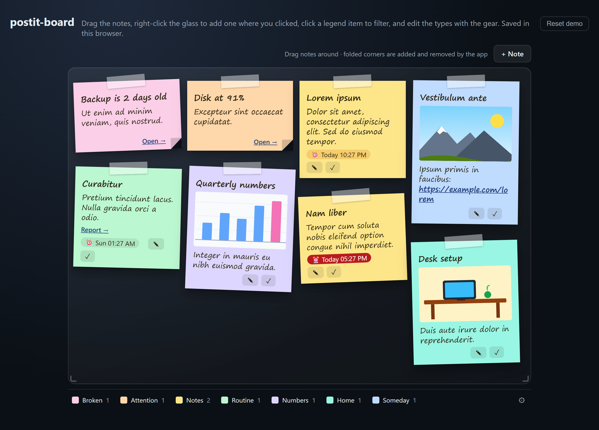
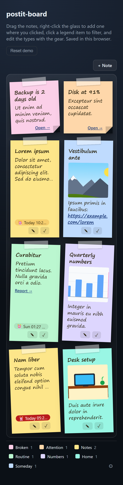
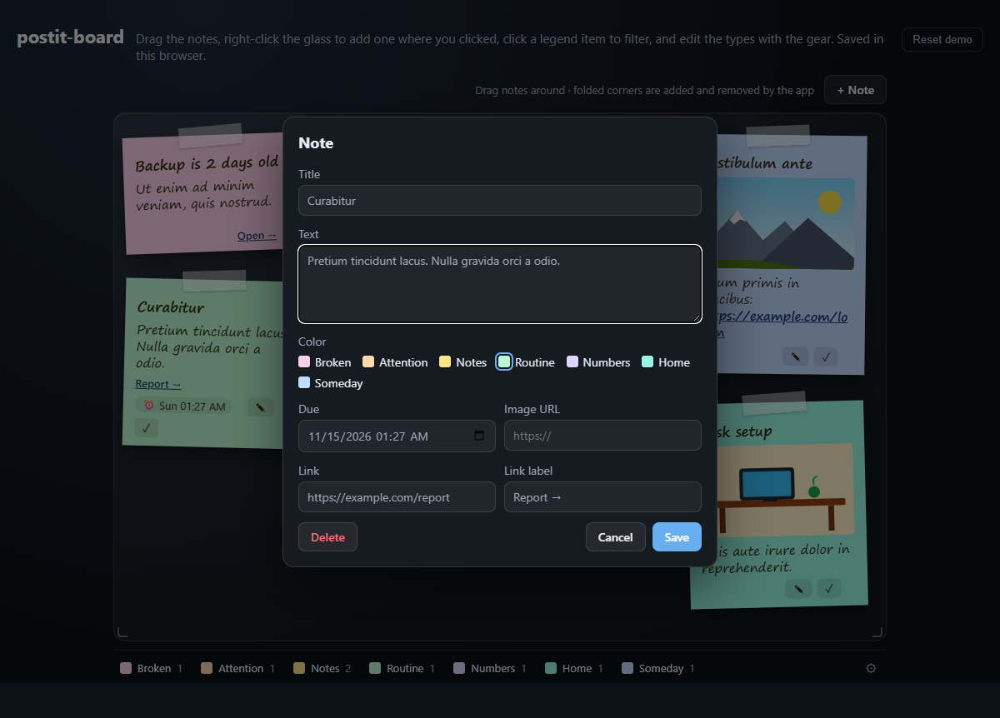
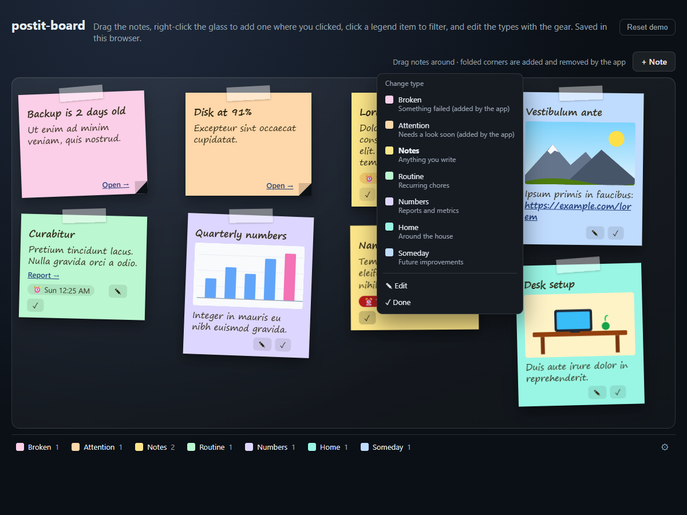
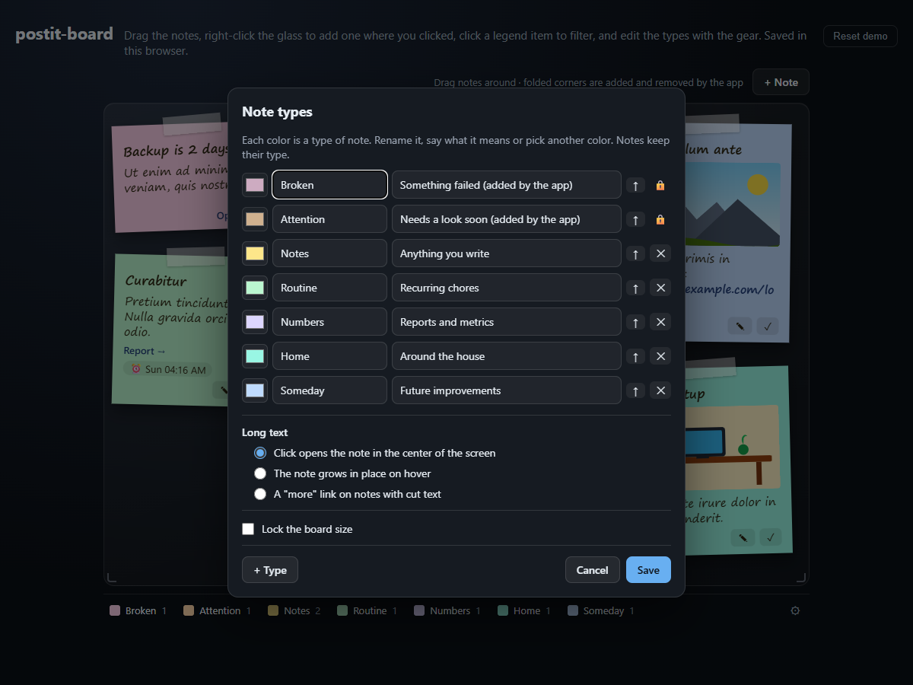

# postit-board

A glass board of sticky notes for the home screen of your app: people drag notes around, your app pins its own (and takes them down when the problem is gone), and a color legend in the footer says what each color means.

Vanilla JS, zero runtime dependencies, about 37 kB unminified. A SQLite store for Node comes with it.



**[Live demo](https://rbritta.github.io/postit-board/demo/)** · [Use it](#use-it) · [Options](#options) · [Server](#server) · [For AI agents](AGENTS.md) · [Roadmap](TODO.md)

## What it does

- **Two kinds of notes.** Notes people write (edit ✎, done ✓) and notes your app computes on every render. App notes have a folded corner, can't be edited, and disappear when your app stops sending them. Only their position is stored.
- **A legend that filters.** Each color gets a meaning in the footer. Click an item to hide or show that color.
- **Right-click to add, right there.** Right-click the glass and pick a type: the note starts exactly where you clicked. Right-click a note to change its type, edit it or mark it done. Shift + right-click keeps the browser menu.
- **Types people can edit.** The gear at the end of the legend renames a type, says what it means, picks another color, adds or removes types. Types your app owns (`locked`) can only be renamed. Saved through the store.
- **Last touched on top.** The note you drag or click comes to the front and stays there after a reload.
- **Due times.** A note can have a due time. The chip turns amber on the day and red when late. On the server, `watchDue` calls you once when the time comes (send a chat message, a push, a calendar event: your call).
- **Images and links.** A note can show an image, a link with a label, and any bare URL in its text becomes a link.
- **Phones too.** Below 700 px wide the board becomes a plain grid: no dragging, no horizontal scroll.
- **Keyboard.** Tab to a note, arrows move it (Shift for bigger steps), Enter edits it.
- **Safe by default.** Every text is escaped, and only `http(s)` and relative URLs are accepted.

<p>
  
  
</p>
<p>
  
  
</p>

## Use it

```sh
npm install github:rbritta/postit-board
```

```html
<link rel="stylesheet" href="node_modules/postit-board/src/postit-board.css">
<div id="board"></div>

<script type="module">
  import { createBoard, restStore } from 'postit-board';

  const board = createBoard(document.getElementById('board'), {
    store: restStore('/api/postits'),
    legend: [
      { color: 'pink', label: 'Broken' },
      { color: 'yellow', label: 'Notes' },
      { color: 'blue', label: 'Someday', description: 'Future improvements' },
    ],
    // what your app computes right now; give each one a stable key
    auto: [{ key: 'disk', title: 'Disk at 91%', color: 'pink', link: '/disk', linkLabel: 'Open →' }],
  });
  board.reload();                       // loads notes and positions from the store

  // later, when your data changes:
  board.update({ auto: computeAlerts() });
</script>
```

No bundler and no modules? Use the classic build, which defines `window.PostitBoard`:

```html
<link rel="stylesheet" href="dist/postit-board.css">
<script src="dist/postit-board.global.js"></script>
<script>PostitBoard.createBoard(el, { store: PostitBoard.localStore('my-board') });</script>
```

## Options

| Option | Default | What it is |
| --- | --- | --- |
| `store` | `null` | Where changes go: `restStore(url)`, `localStore(name)` or your own `{ load, create, update, saveLegend?, saveSize? }`. |
| `legend` | `[]` | `[{ color, label, description?, locked?, hex? }]`, in footer order: the note types. `locked` types belong to the app (rename only). `hex` repaints a color. |
| `auto` | `[]` | App notes: `{ key, title?, text?, color?, link?, linkLabel?, image?, due? }`. |
| `notes` | `[]` | Written notes, if you load them yourself instead of `reload()`. |
| `colors` | built-in | Extra or replaced colors: `{ coral: '#fecaca' }`. Keys are lowercase. |
| `strings` | English | Every visible word, e.g. `{ add: '+ Nota', done: 'Feito', today: 'Hoje' }`. See `DEFAULT_STRINGS`. |
| `locale` | browser | Used to format due times. |
| `defaultColor` | `yellow` | Color of a new note. |
| `addButton` | `true` | Show the "+ Note" button. Double-clicking the glass also adds one. |
| `contextMenu` | `true` | Right-click menu: new note of a type where you clicked, or change a note's type. |
| `editLegend` | store has `saveLegend` | Show the gear that edits the types. |
| `gridBelow` | `700` | Width (px) under which the board is a grid. Keep it equal to the CSS container query. |
| `resizable` | `true` | Drag either bottom corner to resize the board (centered, min 480 × 320 px). Double-click a corner to reset. The gear can lock it. |
| `width` | `0.8` | Default share of the width the board takes (10% margin on each side). |
| `size` | `null` | A saved `{ width, height, locked }` to start with, as `store.load()` returns it. |
| `onError` | `console.error` | Called when the store fails. The board also fires a `postit-error` event. |

The returned board has `update({ notes?, auto?, positions? })`, `reload()`, `configure(options)`, `openEditor(draft?)`, `openSettings()`, `notes`, `legend` and `destroy()`.

The legend people saved comes back in `store.load()` and is merged over the one you pass (`mergeLegend`): their order, names and colors win, and your `locked` types are always there. A note whose type was removed keeps its color, it just leaves the legend.

Built-in colors: `yellow`, `pink`, `green`, `blue`, `orange`, `purple`, `teal`, `gray`. Styling is plain CSS custom properties on `.pb` (`--pb-accent`, `--pb-note-width`, `--pb-font`, `--pb-text-lines` and `--pb-title-lines` for where long text is cut with "…"…). Add `data-theme="light"` for light pages.

## Server

```js
import { DatabaseSync } from 'node:sqlite';            // or better-sqlite3
import { createSqliteStore, createHttpHandler, watchDue } from 'postit-board/server';

const store = createSqliteStore(new DatabaseSync('board.db'));
const handle = createHttpHandler(store, { prefix: '/api/postits' });

http.createServer(async (req, res) => {
  // authenticate and check CSRF first: the handler trusts whoever reaches it
  if (await handle(req, res)) return;
  // ...the rest of your app
}).listen(3000);

watchDue(store, { onDue: (note) => notify(`⏰ ${note.title || note.text}`) });
```

| Route | Body | Answer |
| --- | --- | --- |
| `GET /api/postits` | | `{ notes, positions, legend? }` |
| `POST /api/postits` | a note | the note |
| `PATCH /api/postits/:id` | fields, or `{ done: true }`, or `{ removed: true }` | the note |
| `PUT /api/postits/key/:key` | `{ x, y, z }` | the position of an app note |
| `PUT /api/postits/legend` | `{ legend }` | `{ legend }`, the note types edited with the gear |
| `PUT /api/postits/size` | `{ size }` | `{ size }`, the board size from the corners (and the lock) |

Nothing is deleted: done and removed notes keep their row with a timestamp. Notes accept a `meta` object (JSON) for your own links, like a customer or ticket id. `onChange` on the store gets every create, update, done and remove (and `legend` when the types change), which makes an audit log easy.

## Develop

```sh
npm install          # only playwright-core, for the browser tests and screenshots
npm test             # unit, server and browser tests (installed Chrome; set PW_CHANNEL=msedge for Edge)
npm run demo         # http://localhost:5178/demo/
npm run build        # dist/ (commit it: script-tag users take it from the repo)
npm run screenshots  # regenerates docs/*.png from the demo
```

Node 22.5 or newer (for `node:sqlite` in the tests). Issues and pull requests are welcome; keep it dependency-free.

## License

[MIT](LICENSE)
